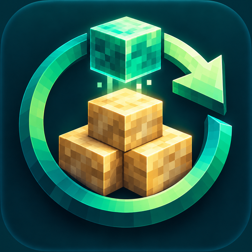

<!-- @file README.md @brief Usage, build instructions, and verification boundaries. @author XiangX (Modolet) @date 2026-10-19 -->
<p align="center"></p>

# Smart Refill

Server-side refill after genuine consumption, with optional Accessories totems and Tom's Simple Storage wireless networks. **Tested with Better MC BMC5 v53** in an isolated full-pack integrated server using automated runtime probes. Independent project; unaffiliated with Better MC, its authors, or Minecraft.

[Source](https://github.com/Modolet/smart-refill) · [Issues](https://github.com/Modolet/smart-refill/issues) · [Releases](https://github.com/Modolet/smart-refill/releases) · [MIT license](LICENSE) · [Test results and outstanding checks](TEST-RESULTS.md)

## Features and boundaries

- Refill blocks and consumables after genuine use, and replace broken tools or armor. Manually removing, moving, swapping, dropping, or sorting items does not create a consumption event. Manual edits cancel pending refills; changing hotbar selection cannot redirect an old refill into the new slot.
- Refill one `minecraft:totem_of_undying` into its original Accessories functional slot after actual consumption. Tested with Accessorify's FAKE_HAND path; requires Accessories and a compatible mod that actually consumes accessory totems. This is not a Curios offhand workaround. Manual unequipping never triggers refill; occupied slots are not overwritten.
- Refill at the player's next server `PlayerTickEvent.Post`, normally the same tick or the next. One pending event per target, no retry polling. Consecutive lethal hits before refill can still kill the player: **no unlimited death protection**.
- Prefer normal inventory, then extract the missing amount from the first accessible Tom wireless network. Works with the storage GUI closed. Multiple terminals use inventory slot order, offhand last; a shortage in the chosen network does not switch to another network.
- **Ordinary wireless terminals require line of sight** to a compatible storage terminal. They have no binding. Advanced terminals use their existing binding. Tom's original distance, dimension, beacon, access, filtering, and loaded-chunk checks remain authoritative. No forced chunk loading.
- **Accessory-carried wireless terminals are not supported.** Carry terminals in normal inventory or offhand. Accessory totem targets and accessory-carried terminal sources are separate features.
- Exact item and data-component matching protects names, potions, enchantments, and container contents. Tool/armor replacements ignore only `minecraft:damage`, require remaining durability, and otherwise match all components. Inventory uses slot order; network tool candidates prefer less damage.
- Extraction counts come from Tom's actual returned stacks, never cached quantities. Partial stock produces a partial refill. Changed/rejecting targets return real items to the source; unreturnable network leftovers go to player inventory, then drop at the player if full. Drops retain normal despawn/environmental risks. Bowls or bottles left in the target are never overwritten.
- No new blocks, world format changes, persistent pending queues, arbitrary client refill requests, or per-tick warehouse scans. Login/respawn/dimension/disconnect events clear pending records.

## Versions and installation

| Component | Tested version | Relationship |
|---|---|---|
| Minecraft | 1.21.1 | Required |
| NeoForge | 21.1.250 | Required; metadata permits 21.1.250 through 21.1.x |
| Better MC BMC5 | v53 | Test environment, not a dependency or endorsement |
| Accessories | 1.1.0-beta.53+1.21.1 | Optional, exact tested API version |
| Accessorify | 2.4.0-beta.5 | Tested accessory-totem consumer; not bundled |
| Tom's Simple Storage | 2.4.2 | Optional, exact tested API version |
| ClientSort | 3.89.0 | Optional, exact tested API version; custom sort/collect cancellation |
| Accessories compatibility layer / Curios | 0.1.12 / 9.5.1 | Present during full-pack tests, not required |
| Legacy mod ID `stackrefill` | Any | Incompatible; remove its JAR from `mods` first |

Missing optional mods disable their integrations safely. Installed untested versions of the three declared optional integrations are rejected by the loader rather than silently using an unverified binary API. The release contains only this project's classes, resources, and license, never Minecraft or dependency JARs.

Singleplayer: install in the instance's `mods` directory; logic executes on the integrated server. Multiplayer: install the same version on server and clients, with matching relevant optional integrations. Dedicated-server multiplayer has **not** been tested; do not treat integrated-server tests as multiplayer acceptance.

Exit the game before replacing mods. Back up the old JAR and refill configuration, move the old JAR outside `mods`, then install Smart Refill. The real instance was left unchanged during development.

## Configuration and localization

`config/smartrefill-common.toml` is generated on first load. Server settings control behavior. English file comments are accompanied by English and Simplified Chinese configuration screens under **Mods → Smart Refill → Config**. Labels, tooltips, source-priority values, and the mod description are localized. Client-side changes do not override a dedicated server's configuration.

| Key | Default | Meaning |
|---|---|---|
| `enabled` | `true` | Master switch |
| `useRefill` | `true` | Genuine right-click exhaustion |
| `foodRefill` | `true` | Completed food/drink use into an empty target |
| `toolRefill` | `true` | Broken tool replacement |
| `armorRefill` | `true` | Broken armor replacement |
| `totemRefill` | `true` | Consumed hand totem |
| `accessoryTotemRefill` | `true` | Consumed Accessories functional-slot totem |
| `wirelessRefill` | `true` | Tom wireless sources |
| `sourcePriority` | `INVENTORY_FIRST` | `INVENTORY_FIRST`, `WIRELESS_FIRST`, or `INVENTORY_ONLY` |

中文配置说明：总开关为 `enabled`；其余开关分别控制使用耗尽、食物饮品、工具、盔甲、主副手图腾、饰品图腾及无线来源。`INVENTORY_FIRST` 为库存优先、无线补足；`WIRELESS_FIRST` 为无线优先、库存补足；`INVENTORY_ONLY` 仅从玩家普通库存取货。普通终端必须看向有效终端，饰品栏携带终端暂不支持。多人以服务端配置为准。

## Build from source

This offline build uses Java 21 and the installed, patched Mojmap Minecraft/NeoForge libraries. No Gradle download or third-party binary redistribution is needed. Install the tested BMC5 instance and its optional compile-time Accessories/Tom JARs first. Default instance: `$HOME/.minecraft/versions/Better MC [BMC5]`; override with `BMC5_INSTANCE`. Its launcher JSON, sibling `libraries`, and assets must exist.

```sh
nix-shell shell.nix --run 'python3 scripts/build.py'
```

Output: `build/libs/smartrefill-neoforge-1.21.1-0.1.1.jar` and `.jar.sha256`. Input hashes are recorded in `build/build-inputs.json`; ZIP timestamps are fixed for reproducibility.

```sh
nix-shell shell.nix --run 'google-java-format --dry-run --set-exit-if-changed $(find src -name "*.java") && ruff check scripts && ruff format --check scripts && python3 scripts/test_install.py'
```

## Isolated runtime tests

```sh
nix-shell shell.nix --run 'python3 scripts/prepare_test.py && python3 scripts/run_test.py'
nix-shell shell.nix --run 'SMARTREFILL_TEST_PROFILE=bare python3 scripts/prepare_test.py && SMARTREFILL_TEST_PROFILE=bare python3 scripts/run_test.py'
```

The scripts create `build/isolated` and `build/isolated-bare`, with new disposable worlds, an offline identity, private Xvfb display, and software rendering. They never copy real saves, accounts, credentials, or server lists. Full-pack tests exclude legacy StackRefill, Numen, DebugBridge, and CrashAssistant; bare tests exclude all external mods. Test plugins are not packaged into the production JAR. Existing isolated worlds are not overwritten: rename earlier output before repeating.

The launcher scripts currently contain host-specific Nix GLFW/Mesa paths and require Xvfb on `PATH`; adjust these for another machine. They stop only their own self-exiting test client and private display. [TEST-RESULTS.md](TEST-RESULTS.md) separates compilation, automated real-game probes, human input acceptance, and dedicated multiplayer.

## Guarded installer and rollback

After building, preview installation without writes:

```sh
python3 scripts/install.py --instance '/path/to/instance'
```

Once the game has fully exited:

```sh
python3 scripts/install.py --instance '/path/to/instance' --apply --game-exited
```

The Linux installer refuses replacement while the target Java session is running or cannot be verified. It backs up refill TOML files and moves old StackRefill/SmartRefill JARs into `smartrefill-backups/<timestamp>/`, outside `mods`, before installing the hash-verified new JAR. Unrelated mods and global configurations are untouched. A checksum receipt records the change.

Exit the game again before rollback:

```sh
python3 scripts/install.py --rollback '/path/to/instance/smartrefill-backups/<timestamp>' --apply --game-exited
```

Rollback checks backup hashes, moves the new JAR outside `mods`, and restores old JARs/configuration. A newly generated Smart Refill configuration may remain harmlessly after uninstall.

## Provenance

This is an independent MIT implementation, not a fork of the legacy `stackrefill-neoforge-1.0.0.jar`. That local binary identifies its author as StackRefill Team and its license as MIT, but provided no confirmed maintainable source or full license text. Its SHA-256 was `0abb6cb360b4392f7c3a7adc55f60a6f910ebb2c3c8b133542f5150a0f20cb4a`. No ownership relationship with similarly named projects is assumed. [Icon provenance](branding/README.md).
